# DO2_Linux Network

## Part 1. Инструмент ipcalc

### 1.1. Сети и маски

* Адрес сети **192.167.38.54/13**: 192.160.0.0

* Перевод маски **255.255.255.0**
    * в префиксную запись: /24
    * в двоичную запись: 11111111.11111111.11111111.00000000

* Перевод маски **/15**
    * в обычную запись: 255.254.0.0
    * в двоичную запись: 11111111.11111110.00000000.00000000

* Перевод маски **11111111.11111111.11111111.11110000**
    * в обычную запись: 255.255.255.240
    * в префиксную запись: /28

* Минимальный и максимальный хост в сети **12.167.38.4** при масках
    * **/8**: 12.0.0.1 - 12.255.255.254
    * **11111111.11111111.00000000.00000000**: 12.167.0.1 - 12.167.255.254
    * **255.255.254.0**: 12.167.38.1 - 12.167.39.254
    * **/4**: 0.0.0.1 - 15.255.255.254

### 1.2. localhost

* Можно ли обратиться к приложению, работающему на localhost, со следующими IP:
    * **194.34.23.100**: нет
    * **127.0.0.2**: да
    * **127.1.0.1**: да
    * **128.0.0.1**: нет

### 1.3. Диапазоны и сегменты сетей

* Какие из перечисленных IP можно использовать в качестве публичного, а какие только в качестве частных:
    * **10.0.0.45**: частный
    * **134.43.0.2**: публичный
    * **192.168.4.2**: частный
    * **172.20.250.4**: частный
    * **172.0.2.1**: публичный
    * **192.172.0.1**: публичный
    * **172.68.0.2**: публичный
    * **172.16.255.255**: частный
    * **10.10.10.10**: частный
    * **192.169.168.1**: публичный

* Какие из перечисленных IP-адресов шлюза возможны у сети **10.10.0.0/18**:
    * **10.0.0.1**: нет
    * **10.10.0.2**: да
    * **10.10.10.10**: да
    * **10.10.100.1**: нет
    * **10.10.1.255**: да

## Part 2. Статическая маршрутизация между двумя машинами

* 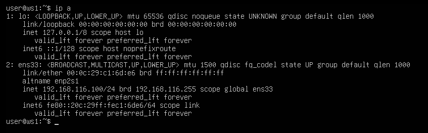  
*Вывод сетевых интерфейсов ws1*

* 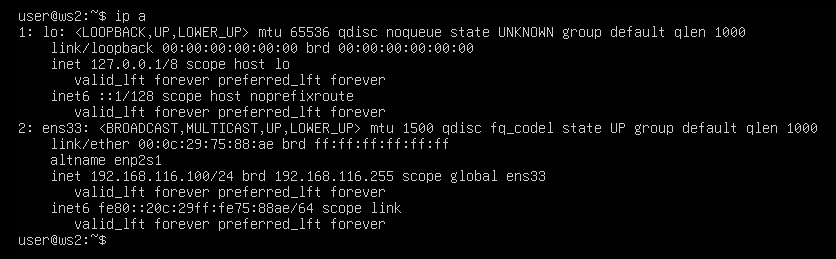  
*Вывод сетевых интерфейсов ws2*

* 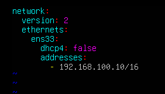  
*Описание сетевого интерфейса для ws1*

* 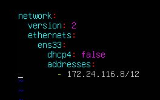  
*Описание сетевого интерфейса для ws2*

* 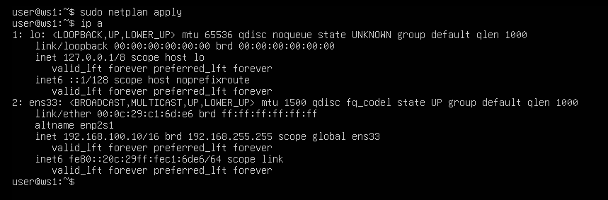  
*Применение сетевого интерфейса для ws1*

* 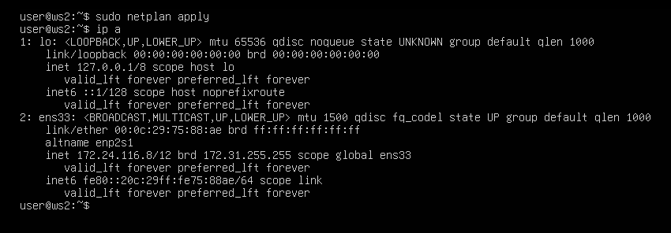  
*Применение сетевого интерфейса для ws2*

### 2.1. Добавление статического маршрута вручную

* 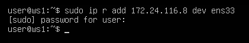  
*Добавление статического маршрута для ws1*

* 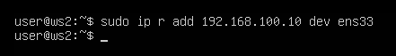  
*Добавление статического маршрута для ws2*

* 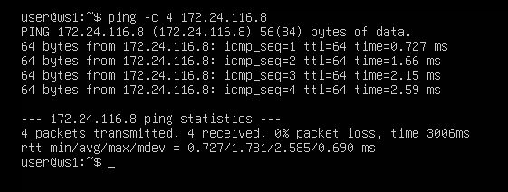  
*Пинг соединения ws1-ws2*

* 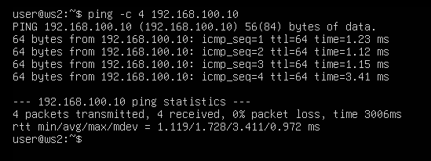  
*Пинг соединения ws2-ws1*

### 2.2. Добавление статического маршрута с сохранением

* 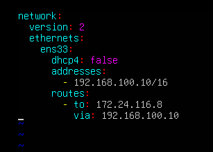  
*Добавление статического маршрута для ws1*

* 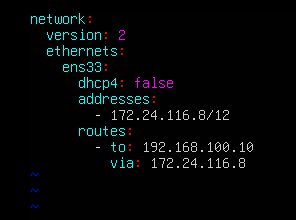  
*Добавление статического маршрута для ws2*

* 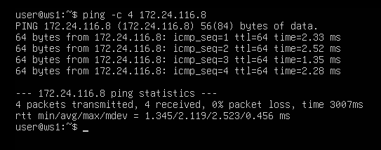  
*Пинг соединения ws1-ws2*

* 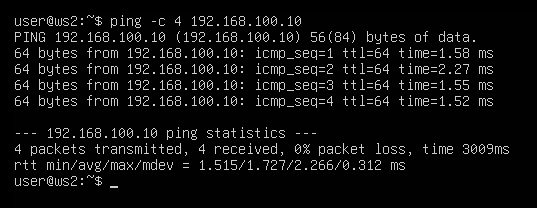  
*Пинг соединения ws2-ws1*

## Part 3. Утилита iperf3

### 3.1. Скорость соединения

* 8 Mbps = 1 MB/s

* 100 MB/s = 819200 Kbps

* 1 Gbps = 1024 Mbps

### 3.2. Утилита iperf3

* 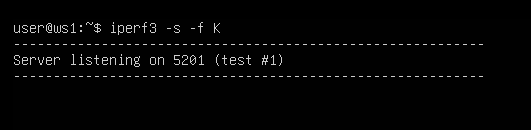  
*Запуск iperf3 на сервере ws1*

* 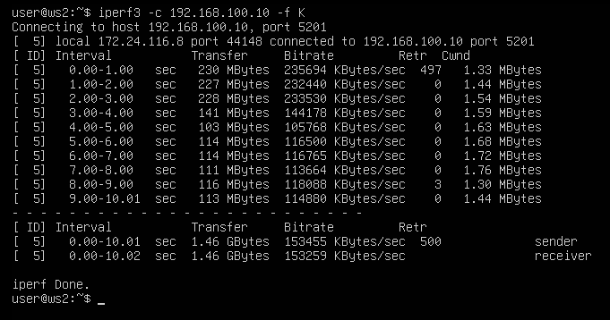  
*Результаты на клиенте ws2*

## Part 4. Сетевой экран

### 4.1. Утилита iptables

* 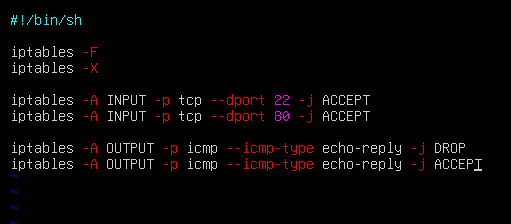  
*Описание /etc/firewall.sh на ws1*

* 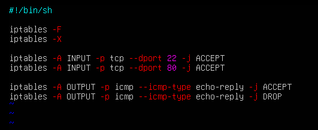  
*Описание /etc/firewall.sh на ws2*

* 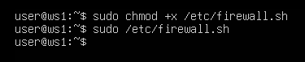  
*Запуск фаервола на ws1*

* 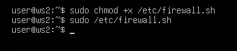  
*Запуск фаервола на ws2*

    * Оба файла содержат одни и те же правила, но в разном порядке. Именно порядок правил определяет итоговое поведение фаервола, потому что iptables обрабатывает правила сверху вниз до первого совпадения.

### 4.2. Утилита nmap

* 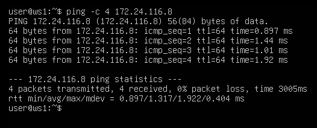  
*Пинг соединения ws1-ws2*

* 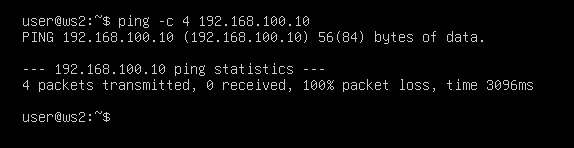  
*Пинг соединения ws2-ws1*

* 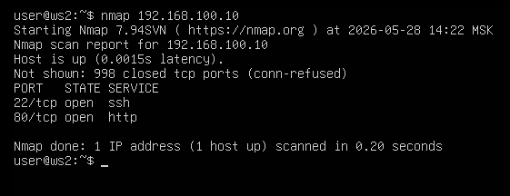  
*Проверка состояния хоста ws1*

## Part 5. Статическая маршрутизация сети

Сеть:
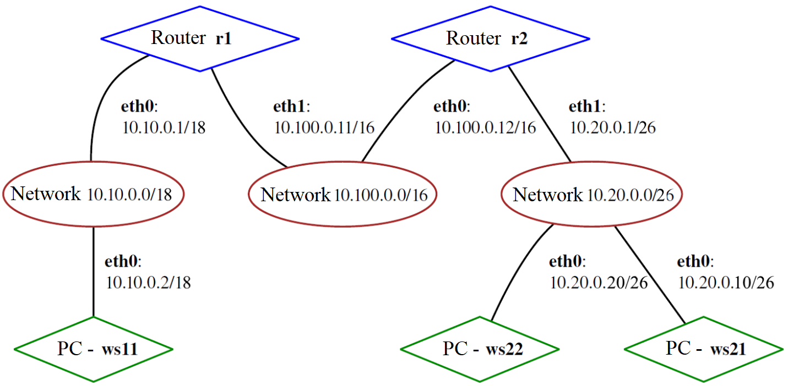

### 5.1. Настройка адресов машин

    eth0 = ens33
    eth1 = ens37

* 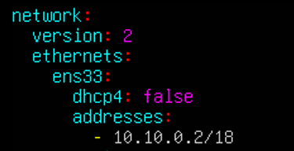  
*Конфиг netplan для ws11*

* 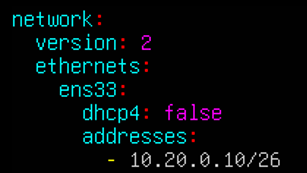  
*Конфиг netplan для ws21*

* 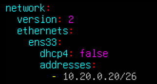  
*Конфиг netplan для ws22*

* 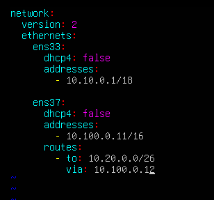  
*Конфиг netplan со статической маршрутизацией для r1*

* 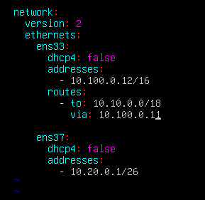  
*Конфиг netplan со статической маршрутизацией для r2*

* 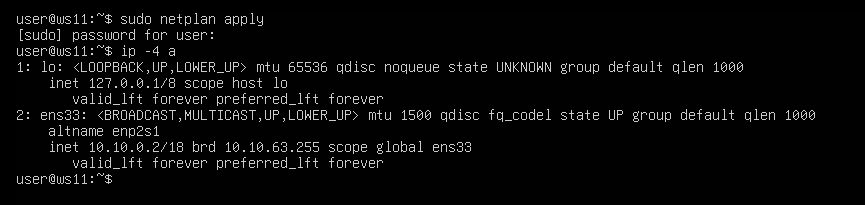  
*Проверка адресов на ws11*

* 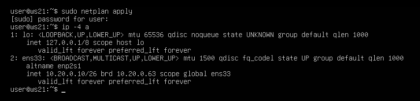  
*Проверка адресов на ws21*

* 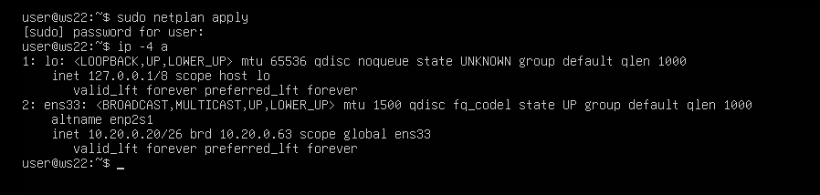  
*Проверка адресов на ws22*

* 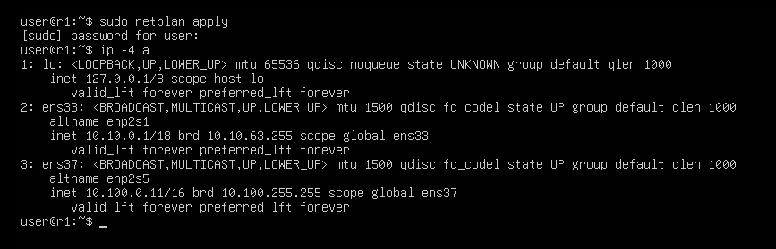  
*Проверка адресов на r1*

* 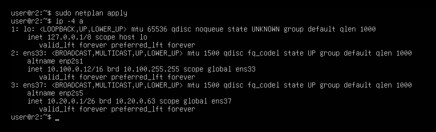  
*Проверка адресов на r2*

* 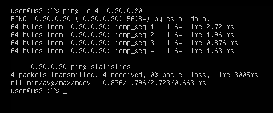  
*Пинг ws22 с ws21*

* 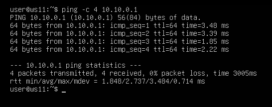  
*Пинг r1 с ws11*

### 5.2. Включение переадресации IP-адресов

* 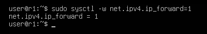  
*Включение переадресации ip для r1*

* 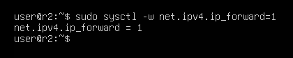  
*Включение переадресации ip для r2*

* 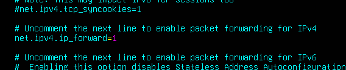  
*Включение постоянной переадресации ip для r1*

* 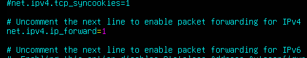  
*Включение постоянной переадресации ip для r2*

### 5.3. Установка маршрута по умолчанию

* 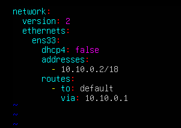  
*Добавление шлюза для ws11*

* 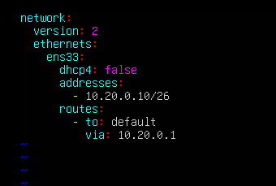  
*Добавление шлюза для ws21*

* 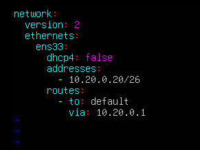  
*Добавление шлюза для ws22*

* 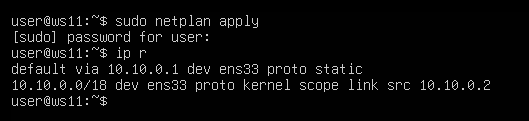  
*Список маршрутов на ws11*

* 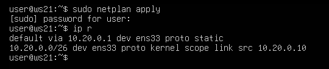  
*Список маршрутов на ws21*

* 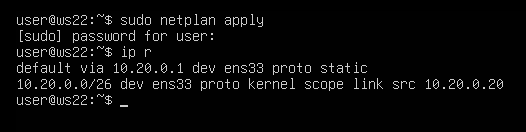  
*Список маршрутов на ws22*

* 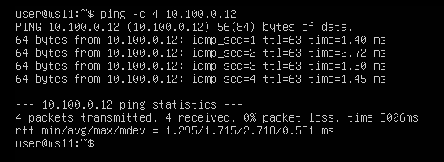  
*Пинг r2 с ws11*

* 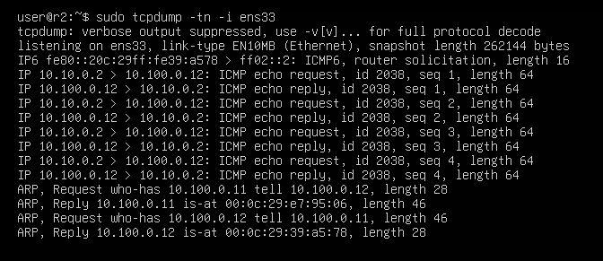  
*Входящие запросы на r2*

### 5.4. Добавление статических маршрутов

    Статические маршруты уже добавлены роутерам в п. 5.1

* 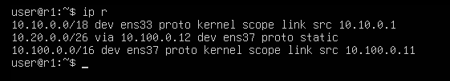  
*Список маршрутов на r1*

* 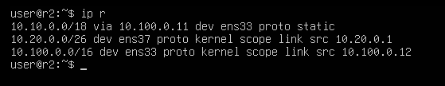  
*Список маршрутов на r2*

*   
*Маршруты до 10.10.0.0/18 и default на ws11*

    * Для адреса 10.10.0.0/18 был выбран маршрут, отличный от 0.0.0.0/0, по правилу самого длинного совпадения префикса.

### 5.5. Построение списка маршрутизаторов

*   
*Запуск tcpdump на r1*

*   
*Список маршрутизаторов на пути от ws11 до ws21*

*   
*Итоговый дамп на r1*

    * Принцип работы traceroute:  
    traceroute отправляет UDP-пакеты на целевой адрес, но с разным значением TTL. TTL - поле в IP-пакете. Каждый маршрутизатор уменьшает TTL на 1. Если TTL стал равен 0, маршрутизатор уничтожает пакет и отправляет обратно сообщение "ICMP time exceeded". Именно по этим ответам traceroute понимает, какие маршрутизаторы стоят на пути.

### 5.6. Использование протокола ICMP при маршрутизации

*   
*Запуск tcpdump на r1*

*   
*Пинг несуществующего адреса с ws11*

*   
*Итоговый дамп на r1*

## Part 6. Динамическая настройка IP с помощью DHCP

*   
*Включение DHCP в netplan для ws21*

*   
*Настройка /etc/dhcp/dhcpd.conf на r2*

*   
*Настройка DNS в /etc/resolv.conf на r2*

*   
*Перезапуск службы DHCP на r2*

*   
*Перезапуск ws21*

*   
*Проверка выданного адреса на ws21*

*   
*Пинг ws22 с ws21*

*   
*Установка MAC адреса и включение DHCP в netplan для ws11*

*   
*Настройка /etc/dhcp/dhcpd.conf на r1*

*   
*Настройка DNS в /etc/resolv.conf на r1*

*   
*Перезапуск службы DHCP на r1*

*   
*Перезапуск ws11*

*   
*Проверка выданного адреса на ws11*

*   
*Пинг ws21 с ws11*

*   
*Получение нового ip адреса на ws21*

    * Использовано:  
        * dhclient -r \<interface>
        * dhclient -v \<interface>

## Part 7. NAT

*   
*Настройка общедоступности сервера apache2 в /etc/apache2/ports.conf на ws22*

*   
*Настройка общедоступности сервера apache2 в /etc/apache2/ports.conf на r1*

*   
*Запуск сервера apache2 на ws22*

*   
*Запуск сервера apache2 на r1*

*   
*Настройка фаервола на r2*

    * Политика по умолчанию: отбрасывать все маршрутизируемые пакеты

*   
*Запуск фаервола на r2*

*   
*Пинг r1 с ws22*

*   
*Пинг ws22 с r1*

*   
*Добавление правила в фаервол на r2*

    * Правило: разрешить маршрутизацию всех пакетов протокола ICMP

*   
*Запуск фаервола на r2*

*   
*Пинг r1 с ws22*

*   
*Пинг ws22 с r1*

*   
*Добавление правил в фаервол на r2*

    * Разрешить маршрутизацию пакетов уже установленных соединений

    * Маскирование всех локальных ip из сети 10.20.0.0/26 под r2 (SNAT)

    * Разрешить маршрутизацию tcp пакетов из сети 10.20.0.0/26 (для SNAT)

    * Перенаправлять tcp пакеты, предназначенные для r2:8080, на ws22:80 (DNAT)

    * Разрешить маршрутизацию tcp пакетов до ws22:80 (для DNAT)

*   
*Запуск фаервола на r2*

*   
*Проверка tcp соединения ws22 -> r1:80*

*   
*Проверка tcp соединения r1 -> r2:8080 -> ws22:80*

## Part 8. Знакомство с SSH Tunnels

*   
*Фаервол на r2*

*   
*Запуск фаервола на r2*

*   
*Настройка сервера apache2 на прослушивание localhost в /etc/apache2/ports.conf на ws22*

*   
*Запуск сервера apache2*

*   
*Local TCP forwarding с ws21 до ws22*

*   
*Проверка соединения ws21-ws22 (при открытой ssh сессии)*

*   
*Remote TCP forwarding с ws11 до ws22*

*   
*Проверка соединения ws11-ws22 (при открытой ssh сессии)*