# DO1_Linux

## Part 1. Установка ОС

* 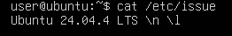  
*Вывод версии Ubuntu*

## Part 2. Создание пользователя

* 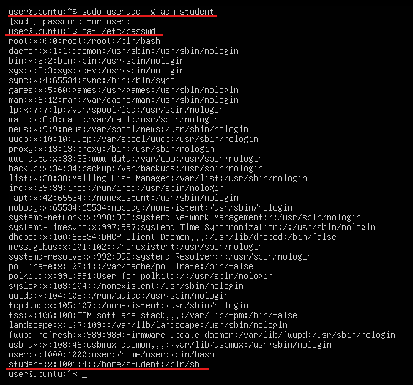  
*Создание и вывод пользователя student с группой adm*

## Part 3. Настройка сети ОС

* 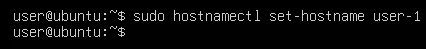  
*Установка имени хоста user-1*

* 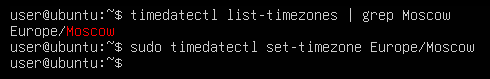  
*Установка временной зоны*

* 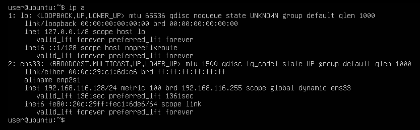  
*Вывод сетевых интерфейсов*
    * lo - loopback-интерфейс. Это виртуальный сетевой интерфейс, который не связан ни с каким физическим оборудованием. Он нужен для того, чтобы компьютер мог обращаться к самому себе по сетевым протоколам.  

* 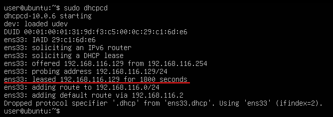  
*Получение ip устройства от DHCP*
    * DHCP (Dynamic Host Configuration Protocol) - протокол динамической настройки узла. Это сетевой протокол, позволяющий устройствам автоматически получать IP-адрес и другие параметры, необходимые для работы в сети.  

* 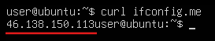  
*Вывод внешнего ip адреса*

* 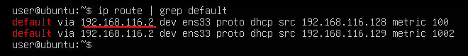  
*Вывод внутреннего ip адреса*

* 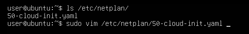  
*Файл конфигурации netplan*

* 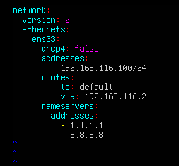  
*Измененный netplan со статичными ip, gw, dns*

* 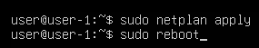  
*Применение netplan и перезагрузка*

* 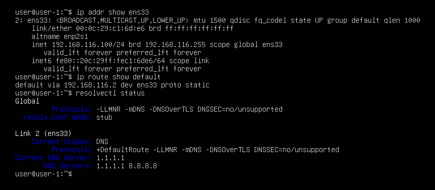  
*Проверка статических ip, gw, dns*

* 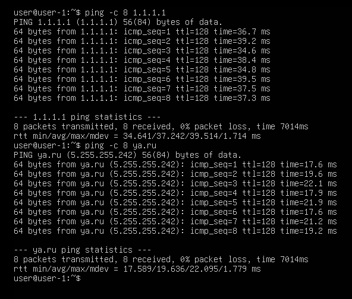  
*Проверка соединения пингом*

## Part 4. Обновление ОС

* 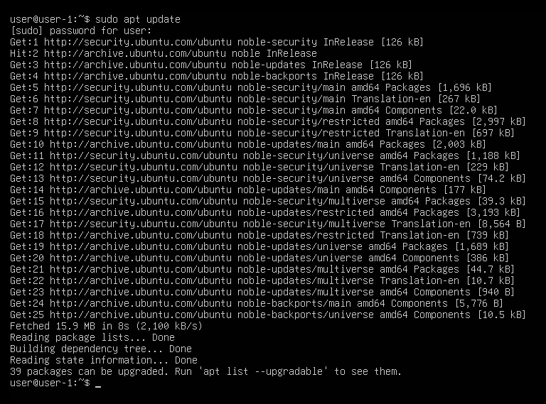  
*Обновление списка пакетов*

* 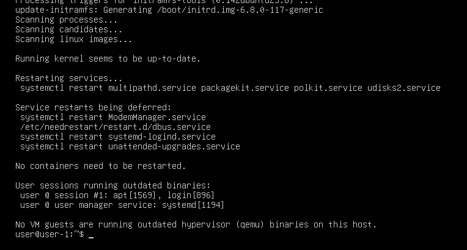  
*Обновление системы*

* 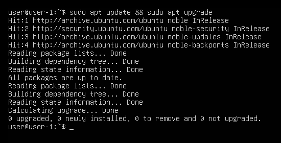  
*Проверка отсутствия новых обновлений*

## Part 5. Использование команды sudo

* sudo (SuperUser DO) - это утилита в UNIX-подобных системах, позволяющая выполнять отдельные команды с привилегиями другого пользователя, не переключаясь полностью в его сессию.  

* 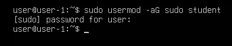  
*Выдача пользователю student группы sudo*

* 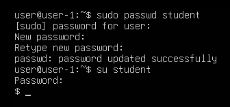  
*Установка пароля для пользователя student и переключение на него*

* 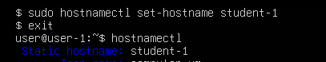  
*Установка имени хоста student-1 от имени student*

## Part 6. Установка и настройка службы времени

* 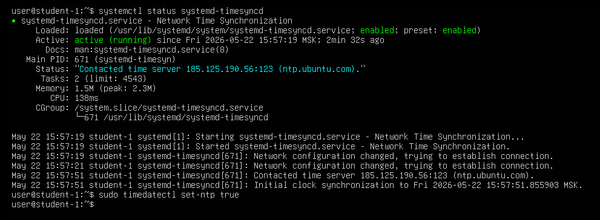  
*Проверка работы службы systemd-timesyncd и включение NTP*

* 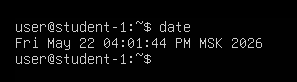  
*Проверка времени*

* 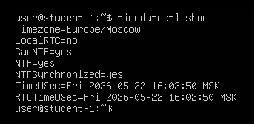  
*Проверка синхронизации времени*

## Part 7. Установка и использование текстовых редакторов

* 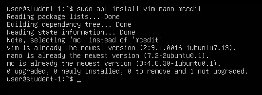  
*Установка текстовых редакторов*

*   
*Содержимое test_vim.txt*

    * Для выхода из vim с сохранением:  
    Esc -> ввести :wq -> Enter

* 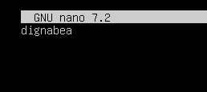  
*Содержимое test_nano.txt*

    * Для выхода из nano с сохранением:  
    Ctrl+O -> Enter -> Ctrl+X

* 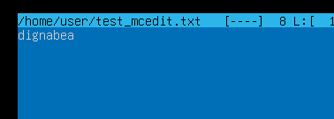  
*Содержимое test_mcedit.txt*

    * Для выхода из mcedit с сохранением:  
    F2 -> Enter -> F10

* 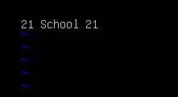  
*Содержимое test_vim.txt после редактирования*

    * Для выхода из vim без сохранения:  
    Esc -> ввести :q! -> Enter

* 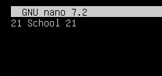  
*Содержимое test_nano.txt после редактирования*

    * Для выхода из nano без сохранения:  
    Ctrl+X -> N

* 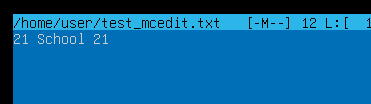  
*Содержимое test_mcedit.txt после редактирования*

    * Для выхода из mcedit без сохранения:  
    F10 -> Выбрать No -> Enter

* 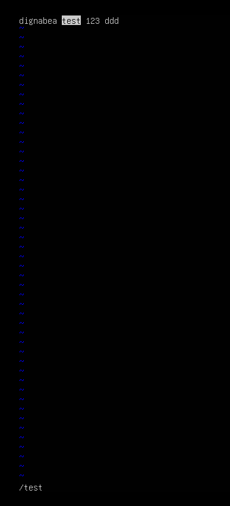  
*Результат поиска в vim*

* 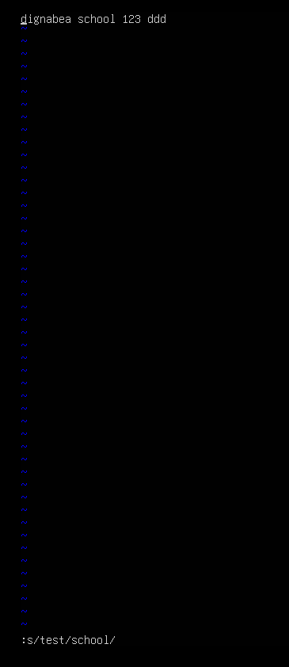  
*Результат замены в vim*

    * Для замены слова в vim:  
    Esc -> ввести :s/слово/замена/ -> Enter

* 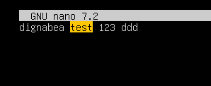  
*Результат поиска в nano*

* 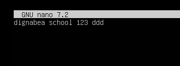  
*Результат замены в nano*

    * Для замены слова в nano:  
    Ctrl+\ -> ввести слово -> Enter -> ввести замену -> Enter -> Y

* 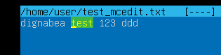  
*Результат поиска в mcedit*

* 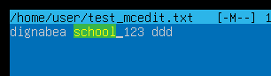  
*Результат замены в mcedit*

    * Для замены слова в mcedit:  
    F4 -> ввести слово -> ввести замену -> Enter -> выбрать Yes

## Part 8. Установка и базовая настройка сервиса SSHD

* 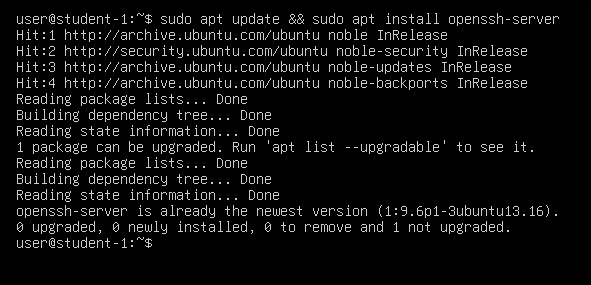  
*Установка службы ssh*

* 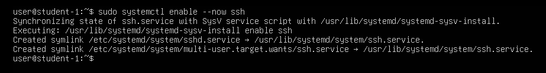  
*Включение службы ssh и ее автозапуска*

* 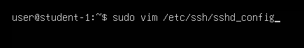  
*Открытие конфига sshd*

* 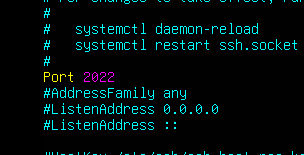  
*Изменение порта*

* 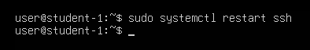  
*Перезапуск службы ssh*

* 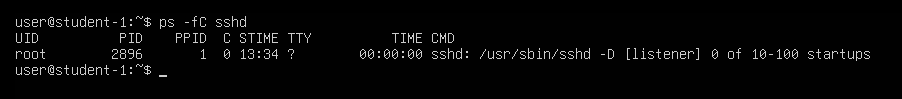  
*Вывод команды ps -fC sshd*

    * Команда ps (process status) используется для отображения информации о запущенных процессах в системе.
    * Ключи:
        * -C sshd (command) - выбрать процессы по точному имени исполняемого файла

        * -f (full format) - вывести расширенную информацию о процессе

* 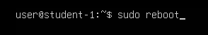  
*Перезапуск системы*

* 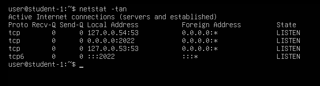  
*Вывод команды netstat -tan*

    * Ключи:
        * -t (TCP) - показать только сокеты, работающие по протоколу TCP

        * -a (all) - показать все сокеты (в состоянии LISTEN)

        * -n (numeric) - отображать числовые значения IP-адресов и портов
    * Столбцы:
        * Proto - протокол, используемый сокетом

        * Recv-Q - количество байт, полученных от удалённого хоста и ожидающих обработки локальным приложением

        * Send-Q - количество байт, отправленных локальным приложением, но ещё не подтверждённых удалённой стороной

        * Local Address - локальный IP-адрес и порт, участвующие в соединении

        * Foreign Address - удалённый IP-адрес и порт
        
        * State - состояние TCP-сокета
    * 0.0.0.0 означает «все доступные IP-адреса на данной машине»

## Part 9. Установка и использование утилит top, htop

* 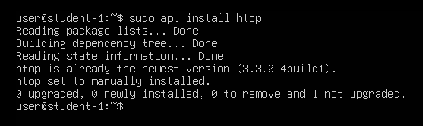  
*Установка утилиты htop*

* 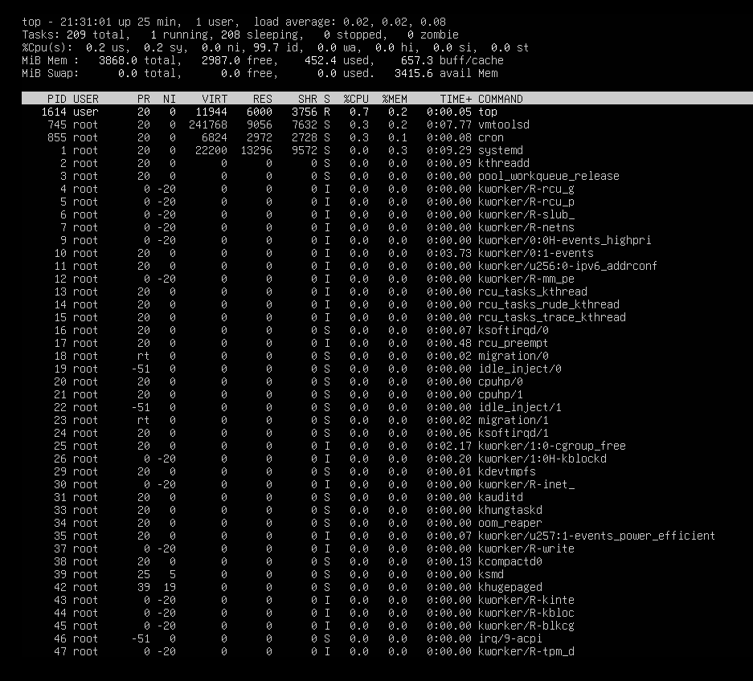  
*Вывод команды top*

    * uptime: 25 минут
    * Авторизованных пользователей: 1
    * Средняя загрузка системы:
        * 0.02 за 1 минуту
        * 0.02 за 5 минут
        * 0.03 за 15 минут
    * Общее количество процессов: 209
    * Загрузка cpu:
        * пользовательские: 0.2%
        * системные: 0.2%
        * свободно: 99.7%
    * Загрузка памяти:
        * всего: 3868 МБ
        * свободно: 2987 МБ
        * использовано: 452.4 МБ

* 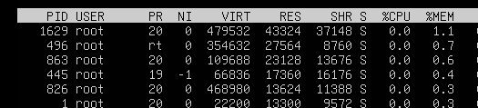  
*Сортировка по памяти (Shift+M)*

    * pid процесса, занимающего больше всего памяти: 1629

* 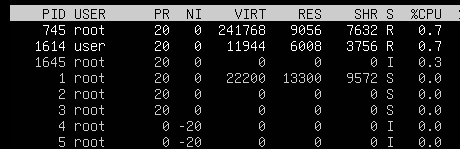  
*Сортировка по процессорному времени (Shift+P)*

    * pid процесса, занимающего больше всего процессорного времени: 745

* 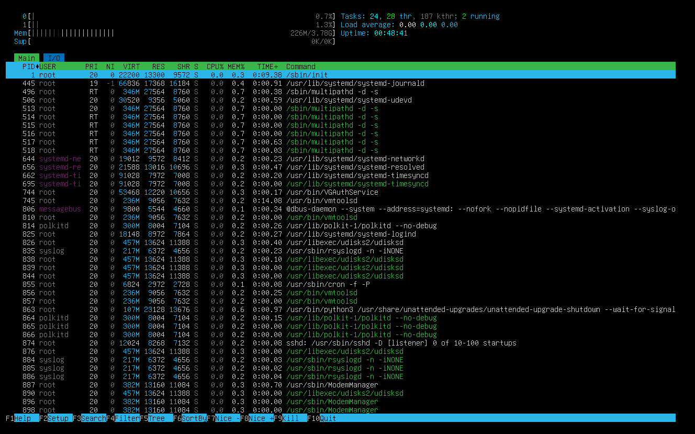  
*Вывод htop, отсортированный по PID (F6)*

* 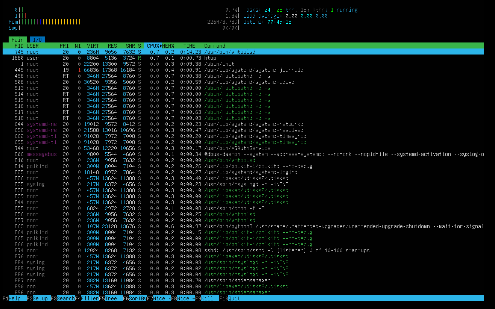  
*Вывод htop, отсортированный по PERCENT_CPU (F6)*

* 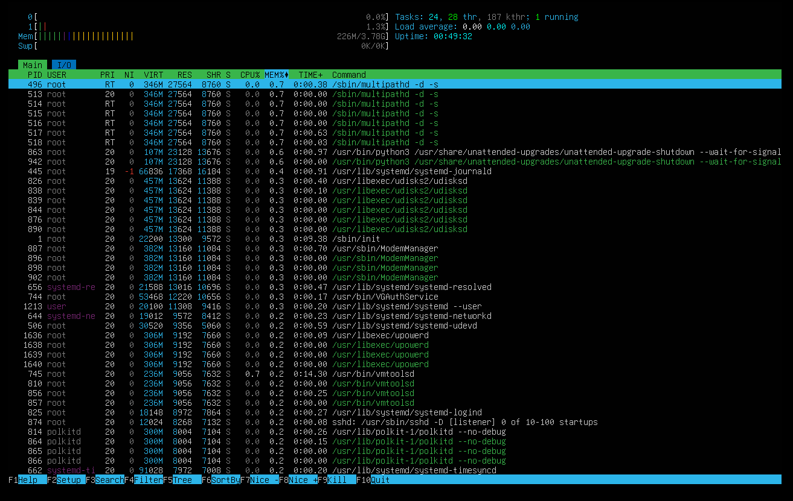  
*Вывод htop, отсортированный по PERCENT_MEM (F6)*

* 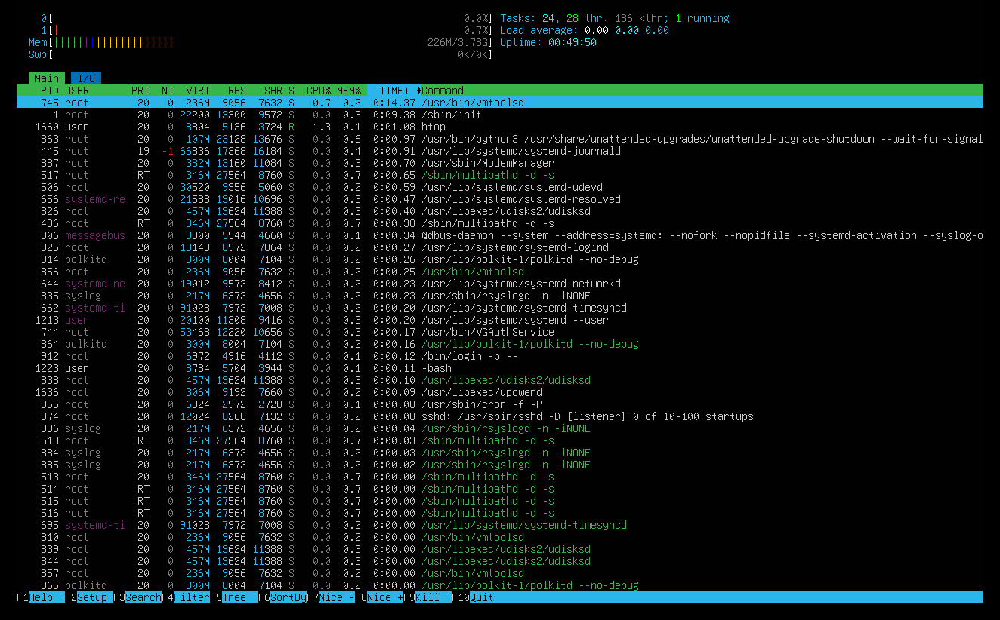  
*Вывод htop, отсортированный по TIME (F6)*

*   
*Вывод htop, отфильтрованный для процесса sshd (F4)*

*   
*Вывод htop с процессом syslog, найденным, используя поиск (F3)*

*   
*Вывод htop с добавленным выводом hostname, clock и uptime (F2 -> Meters)*

## Part 10. Использование утилиты fdisk

*   
*Вывод команды fdisk -l*

    * Имя жесткого диска: /dev/sda
    * Размер: 20 ГБ
    * Количество секторов: 41943040
    * Раздела подкачки нет

## Part 11. Использование утилиты df

*   
*Вывод команды df (корневой раздел /)*

    * Единица измерения: 1K-blocks (KiB)
    * Размер раздела: 10218772 КБ
    * Размер занятого пространства: 2996828 КБ
    * Размер свободного пространства: 6681272 КБ
    * Процент использования: 31%

*   
*Вывод команды df -Th (корневой раздел /)*

    * Тип файловой системы: ext4
    * Размер раздела: 9.8 ГБ
    * Размер занятого пространства: 2.9 ГБ
    * Размер свободного пространства: 6.4 ГБ
    * Процент использования: 31%

## Part 12. Использование утилиты du

*   
*Вывод команды du*

*   
*Размеры папок /home, /var, /var/log в байтах*

*   
*Размеры папок /home, /var, /var/log в человекочитаемом виде*

*   
*Размеры содержимого /var/log в человекочитаемом виде*

## Part 13. Установка и использование утилиты ncdu

*   
*Установка утилиты ncdu*

*   
*Вывод размера /home через sudo ncdu /home*

*   
*Вывод размера /var через sudo ncdu /var*

*   
*Вывод размера /var/log через sudo ncdu /var/log*

## Part 14. Работа с системными журналами

*   
*Вывод последних 10 записей из /var/log/dmesg*

*   
*Вывод последних 10 записей из /var/log/syslog*

*   
*Вывод последних записей авторизации из /var/log/auth.log*

    * Время последней успешной авторизации: 2026-05-26 09:19:38+03:00
    * Пользователь: user
    * Метод входа: login

*   
*Перезапуск службы ssh*

*   
*Вывод /var/log/syslog после перезапуска ssh*

## Part 15. Использование планировщика заданий CRON

*   
*Открытие планировщика заданий*

*   
*Добавление новой задачи*

*   
*Логи выполнения заданий CRON в /var/log/syslog*

*   
*Список заданий CRON*

*   
*Удаление всех заданий и вывод списка заданий CRON*